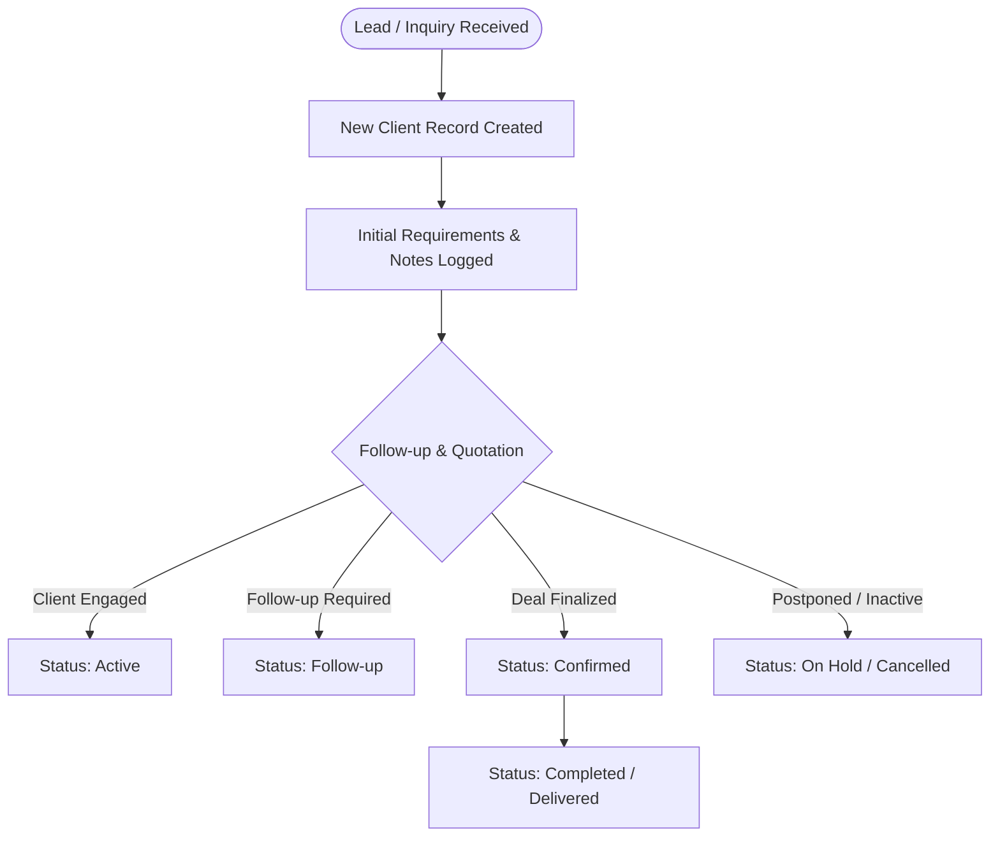
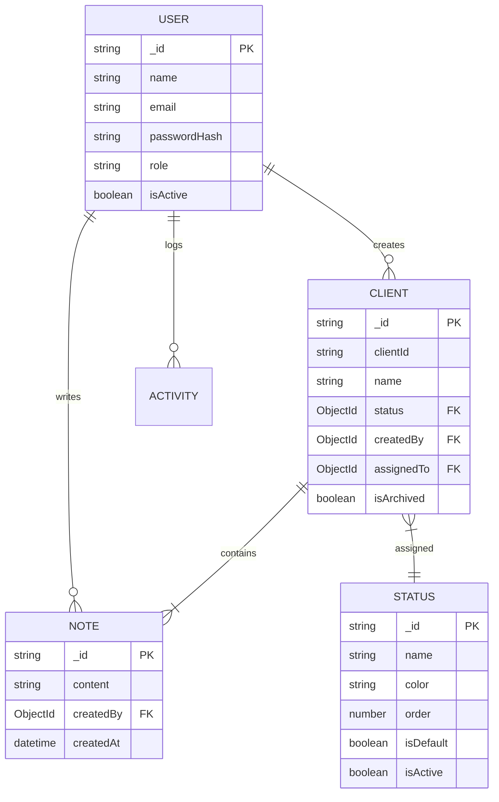

# Reelman Production CMS

A focused Client & Lead Management System tailored for photo and video production studios, media houses, and creative agencies.

---

## Architecture & Technology Stack

| Layer | Technology |
|---|---|
| **Framework** | Next.js (App Router) |
| **Language** | TypeScript |
| **Styling** | Tailwind CSS |
| **Components** | Radix UI / shadcn-style UI primitives |
| **Icons** | Lucide React |
| **Database** | MongoDB + Mongoose ODM |
| **Authentication** | JWT (`jose`) + `bcryptjs` (HTTP-only secure cookies) |
| **Validation** | Zod |
| **Notifications** | Sonner (Toasts) |

---

## System Workflows & Diagrams

### 1. Client Lead Lifecycle



### 2. Entity Relationships (ER Diagram)



---

## Route Overview

| Route | Description |
|---|---|
| `/login` | User authentication & session generation |
| `/register` | User registration (First user is automatically assigned Admin role) |
| `/` | Main dashboard with client KPI cards, recent clients & recent activity |
| `/clients` | Client directory with live search, stage filters, and sorting |
| `/clients/[id]` | Client profile (Notes timeline, stage selector, status history & logs) |
| `/activity` | System-wide audit trail and event logs |
| `/team` | Team roster management & role controls (Admin only) |
| `/settings` | Pipeline status manager with color picker and seed controls |

---

## Default Pipeline Statuses

| Status | Color | Description |
|---|---|---|
| **New** | `#6366f1` (Purple) | Incoming inquiry / fresh lead |
| **Active** | `#22c55e` (Green) | Engaged and responsive client |
| **Pending** | `#f59e0b` (Amber) | Awaiting proposal or quotation response |
| **Follow-up** | `#8b5cf6` (Violet) | Scheduled for follow-up communication |
| **Confirmed** | `#06b6d4` (Cyan) | Booking finalized |
| **In Progress** | `#3b82f6` (Blue) | Shoot or work underway |
| **Completed** | `#10b981` (Emerald) | Project completed |
| **Payment Pending** | `#f97316` (Orange) | Work completed, awaiting balance |
| **Cancelled** | `#ef4444` (Red) | Client dropped or cancelled |
| **On Hold** | `#6b7280` (Gray) | Lead or project on hold |

---

## Role-Based Permissions Matrix

| Feature | Admin | Staff |
|---|:---:|:---:|
| View clients & details | ✅ | ✅ |
| Add new clients | ✅ | ✅ |
| Edit client details | ✅ | ✅ |
| Delete / Archive clients | ✅ | ✅ |
| Add notes to clients | ✅ | ✅ |
| Delete notes | ✅ | Own notes only |
| Manage pipeline statuses | ✅ | ❌ |
| Manage team members | ✅ | ❌ |
| View global activity audit | ✅ | ✅ |

---

## Quick Setup & Running

```bash
# 1. Clone or navigate to the project directory
cd /home/mohammad-shaheer/.gemini/antigravity/scratch/reelman-cms

# 2. Configure MongoDB connection in .env.local
# Default: MONGODB_URI=mongodb+srv://.../reelman-cms?retryWrites=true&w=majority
# JWT_SECRET=your-secret-key

# 3. Start development server
npm run dev

# 4. Open in browser:
# http://localhost:3000

# 5. Register the first admin user at:
# http://localhost:3000/register
```
